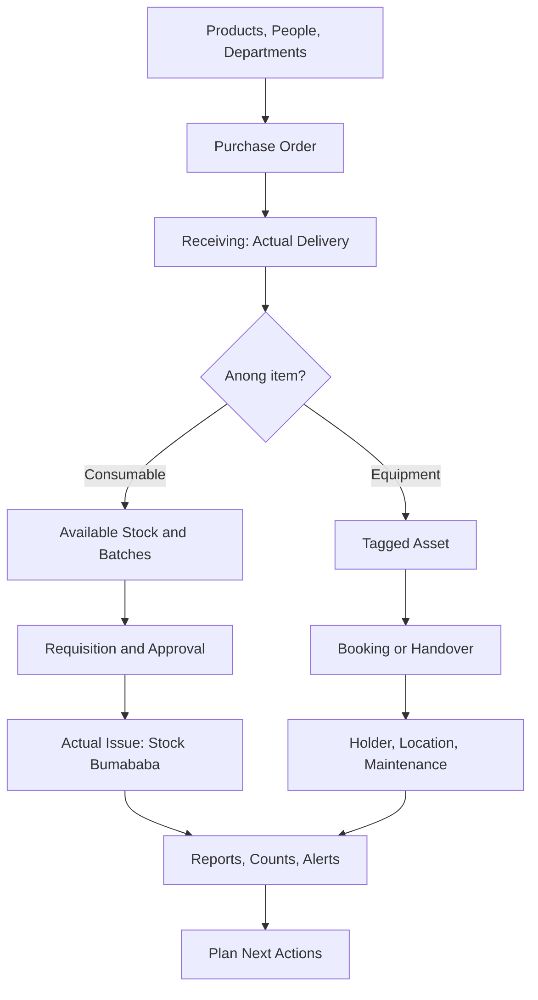

# 01 — PUP-PRISM: Ano ang System at Sino ang Gumagamit?

## 1. Ano ba talaga ang PUP-PRISM?

Imagine na may university na maraming office supplies at equipment: bond paper, ballpen, printer ink, laptops, projectors, at iba pa. Kung iba-iba ang notebook, spreadsheet, o papel na gamit ng bawat office, mahirap sagutin ang mga tanong na:

- Ilang items pa ang nasa stockroom?
- May parating pa bang bagong delivery?
- Sino ang humiram o may hawak ng projector?
- Approved na ba ang request ng isang department?
- May equipment bang sira, nawawala, o kailangan nang palitan?
- Kailan tayo dapat mag-order ulit?

**Dito pumapasok ang PUP-PRISM.** Pinagsasama niya ang records at processes sa isang web-based system. Ang goal ay mas madaling ma-track ang supplies, equipment, requests, deliveries, at mga taong involved.

Hindi ibig sabihin na automatic nang ginagawa ng system ang lahat. Halimbawa, pwede siyang mag-suggest na bumili ng stock, pero **tao pa rin ang magche-check at mag-aapprove ng actual purchase**.

## 2. Dalawang importanteng klase ng items

### A. Consumables — mga gamit na nauubos

Ito 'yung mga item na ginagamit at nababawasan ang stock, gaya ng bond paper, ink, at ballpen.

**Example:** May 100 ballpen sa stockroom. Nag-issue ng 20 sa isang office. Kapag na-record na ang actual release, magiging **80** ang available stock (assuming walang ibang changes).

### B. Assets — equipment na ginagamit nang paulit-ulit

Ito naman ang mga gamit gaya ng laptop, projector, o computer. May sariling **asset tag** o unique code ang bawat unit para matukoy kung alin mismo ang pinag-uusapan.

**Example:** May dalawang laptop na same brand at model. Kahit magkapareho sila, dapat magkahiwalay ang record kasi baka ang Laptop A ay hawak ng Office 1 at ang Laptop B ay nasa storage.

**Pinakaimportanteng difference:** Sa consumables, madalas **quantity** ang nagbabago. Sa assets, mahalagang malaman ang **specific unit, location, condition, at kung sino ang responsible**. Hindi automatic na nababawasan ang total owned assets kapag pinahiram ang isang laptop.

## 3. Sino-sino ang main users?

| User role | Simple explanation | Madalas nilang ginagawa |
|---|---|---|
| **Admin** | Siya ang nag-aasikaso sa access at overall records ng system. | Users, departments, categories, locations, stock adjustments, audit logs, system monitoring. |
| **Supply Head** | Siya ang nakatutok sa supplies at pag-order. | Suppliers, purchase orders, receiving, requisition approval/issuance, forecasts, alerts. |
| **Property Custodian** | Siya ang nagta-track ng equipment at kung sino ang may hawak nito. | Assets, booking, handover, maintenance, transfers, physical counts. |

**Tandaan:** Hindi porket nabubuksan ng isang role ang page ay pwede na niyang gawin lahat ng buttons. Bawat action, tulad ng approve, edit, o delete, pwede pa ring may hiwalay na permission check.

## 4. Mga common terms na kailangan maintindihan

| Term sa system | Sa simpleng Taglish |
|---|---|
| **Product** | Entry ng isang klase ng item, tulad ng “Bond Paper A4” o “Laptop Model X.” |
| **SKU** | Unique product code para mabilis mahanap ang product. |
| **Asset Tag** | Sariling code ng isang **specific** laptop, projector, o equipment. |
| **Stock / On Hand** | Dami ng item na recorded na hawak ng university sa ngayon. |
| **Lot / Batch** | Isang set ng supplies na sabay dumating; may sarili nitong delivery at minsan expiry details. |
| **Supplier** | Company o tao na pinag-oorderan ng items. |
| **Purchase Order / PO** | Official record ng mga item na gustong bilhin sa supplier. |
| **Receiving** | Pag-record na **talagang dumating** ang delivery. |
| **Requisition** | Request ng office o department para sa supplies. |
| **Approval** | Pagpayag sa request o action. Hindi pa ito automatic release ng item. |
| **Issuing** | Actual na pag-release ng supplies; dito nagbabago ang stock. |
| **Booking** | Pag-reserve ng specific equipment para sa isang date/time. |
| **Handover** | Paglipat ng responsibility sa equipment, kasama ang confirmation ng tatanggap. |
| **Maintenance** | Pag-record ng repair o servicing ng equipment. |
| **Asset Transfer** | Request para ilipat ang location o assignment ng equipment. |
| **Physical Count** | Bilangin ang totoong items at ikumpara sa bilang sa system. |
| **Stock Movement** | History kung kailan at bakit nadagdagan o nabawasan ang stock. |
| **FEFO** | Unahing gamitin ang **valid stock na pinakamalapit mag-expire**. |
| **Forecast** | Estimate kung gaano karaming supplies ang posibleng kailanganin sa future. |
| **Alert** | Warning na may kailangang pansinin, gaya ng low stock. |
| **Notification** | Message para ipaalam sa user ang update o warning. |
| **Audit Log** | History kung sino ang gumawa ng action at kailan. |
| **Trash / Restore** | Pwedeng ibalik ang record na tinanggal muna sa normal list, kung allowed. |

## 5. Paano nagkakabit ang lahat?

Ganito ang simple na flow ng supplies:

1. **Products:** I-register muna kung anong item ang minamanage.
2. **Suppliers at Purchase Orders:** Piliin kung saan bibili at gumawa ng order.
3. **Receiving:** Kapag dumating ang order, saka i-record ang aktwal na quantity.
4. **Stock:** Maa-update ang available supplies at delivery batches.
5. **Requisitions:** Magre-request ang department ng kailangan nila.
6. **Approval at Issuing:** Ire-review ang request; kapag actual nang na-issue, doon bababa ang stock.
7. **Reports, Alerts, at Forecasting:** Makikita ang history, low-stock warnings, at estimated future needs.

Para naman sa reusable equipment:

1. **Products at Assets:** I-register ang product type at bawat actual equipment na may sariling tag.
2. **Booking:** I-reserve kung gagamitin sa specific schedule.
3. **Handover:** I-record kung sino ang tatanggap at ipa-confirm sa kanya.
4. **Location / Maintenance / Transfer:** I-track kung saan ito nakalagay, kung may repair, o kung ililipat.
5. **Physical Count / Reports / Audit:** I-check kung existing pa ang unit at ma-review ang history.

### Simpleng system map

## 6. Paano gumagana ang website sa likod? (Simple version)

Kapag nag-click ka ng **Save**, hindi ibig sabihin na diretso nang binabago ng button ang database. Ganito ang basic process:

1. Magfi-fill out ka ng form sa website.
2. Ipapadala ng website ang info sa backend (parte ng system na nagpo-process ng requests).
3. Iche-check kung **logged in** ka, kung **allowed** ka sa action, at kung **tama** ang nilagay mo.
4. Kapag okay, ise-save ng system ang changes sa database at i-update ang related records kung kailangan.
5. Ipapakita ang result, tulad ng “Stock received” o error kung may kailangang ayusin. Sa ibang actions, may history at notifications din.

**Example:** Kung nag-receive ka ng 15 printer ink, hindi lang “15” ang sinasave. Pwede ring may record kung kailan dumating, anong product, anong PO kung meron, at sino ang nag-encode.

## 7. Technologies na gamit (based sa README)

Hindi mo kailangang kabisaduhin agad lahat. Ito lang muna ang role ng bawat isa:

| Technology | Ano ang trabaho niya? |
|---|---|
| **Laravel / PHP** | Nagpo-process ng actions, rules, at data sa likod ng website. |
| **Vue / Inertia / TypeScript / Tailwind** | Gumagawa ng pages, forms, buttons, at design na nakikita ng user. |
| **PostgreSQL** | Dito naka-save ang structured records ng system. |
| **Fortify / Sanctum / 2FA / Roles** | Para sa login, account protection, at permissions. |
| **Reverb / Notifications** | Para sa updates at messages, depende kung naka-set up ang server. |
| **PDF / CSV tools** | Para makagawa ng downloadable reports at documents. |
| **Pest / Playwright** | Para ma-test ng developers kung gumagana ang system. |

## 8. Maikling explanation na pwede mong sabihin sa defense

> Ang PUP-PRISM ay isang web-based system para sa university supplies at equipment. Dito namin tine-track ang items mula pag-register, pag-order, at pag-receive, hanggang sa pag-request, pag-release, at pag-check ng stock. May separate process din para sa equipment, tulad ng booking, handover, maintenance, at transfer. May reports at alerts din para mas madaling malaman ang current status at kung ano ang kailangang asikasuhin. Ang goal namin ay maging mas organized, mas accurate, at mas madaling ma-track kung sino ang responsible sa bawat action.

**Basahin next:** [02 — Lahat ng Modules, Explained in Taglish](02-ALL-MODULES.md)
