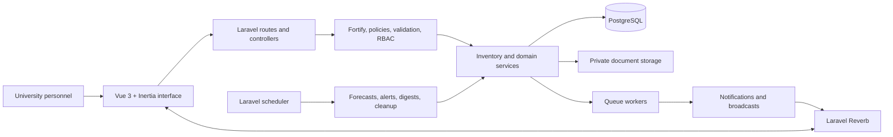

<p align="center">
  
</p>

<h1 align="center">PUP PRISM</h1>

<p align="center">
  <strong>Property, Resource, Inventory, and Supply Management</strong><br>
  A secure operations platform for university inventory, procurement, assets, and accountable decision-making.
</p>

<p align="center">
  
  
  
  
  
</p>

---

## About PRISM

PUP PRISM is a web-based university operations system for managing consumable supplies and accountable property throughout their complete lifecycle. It connects receiving, stock issuance, procurement, physical counting, bookings, handovers, maintenance, transfers, forecasting, reporting, and audit history in one controlled workspace.

The platform is designed for three priorities:

- **Accuracy** — stock, lot, asset, and procurement records remain consistent and traceable.
- **Accountability** — approvals, handovers, adjustments, and lifecycle decisions record who performed each action.
- **Operational clarity** — dashboards, alerts, forecasts, and reports turn inventory data into understandable next steps.

> [!IMPORTANT]
> This repository is under active development. Review the [operations runbooks](docs/operations/), [implementation tracking](docs/system-improvement/IMPLEMENTATION_TRACKING.md), and latest [system improvement reports](docs/system-improvement/) before deploying it in a live environment.

## Contents

- [What the system can do](#what-the-system-can-do)
- [Roles and access](#roles-and-access)
- [Technology stack](#technology-stack)
- [System architecture](#system-architecture)
- [Local installation](#local-installation)
- [UAT accounts](#uat-accounts)
- [Development workflow](#development-workflow)
- [Testing and quality checks](#testing-and-quality-checks)
- [Automation and operations](#automation-and-operations)
- [Production deployment](#production-deployment)
- [Project structure](#project-structure)
- [Documentation](#documentation)
- [Troubleshooting](#troubleshooting)

## What the system can do

| Area                       | Capabilities                                                                                                               | Operational value                                                                              |
| -------------------------- | -------------------------------------------------------------------------------------------------------------------------- | ---------------------------------------------------------------------------------------------- |
| **Inventory control**      | Products, stock balances, stock lots, receiving, issuance, adjustments, movements, QR labels, and soft-delete recovery     | Maintains a reliable record of what is available and how quantities changed                    |
| **Physical counting**      | Count sessions, assigned personnel, frozen expectations, draft counts, discrepancies, review, approval, and reconciliation | Keeps physical counts separate from official balances until an authorized adjustment is posted |
| **Requisitions**           | Requests, templates, approval or rejection, partial issuance, bulk actions, and issuance history                           | Gives departments a traceable supply-request workflow                                          |
| **Procurement**            | Suppliers, purchase orders, controlled numbering, sending, receiving, cancellation, and pending replenishment              | Connects supply needs to an accountable purchasing process                                     |
| **Smart inventory**        | Demand forecasting, backtesting, ABC classification, safety stock, EOQ, reorder recommendations, and stockout alerts       | Helps personnel understand future needs without automatically approving purchases              |
| **Lot and expiry control** | Expiration monitoring, near-expiry alerts, expired-lot quarantine, and FEFO issuance                                       | Prioritizes valid stock with the earliest expiration while protecting quantity integrity       |
| **Asset operations**       | Asset records, bookings, QR-assisted handovers, signatures, PDF receipts, assignments, and condition tracking              | Tracks custody and availability of university property                                         |
| **Asset lifecycle**        | Maintenance, locations, transfers, retirement, disposal workflows, and historical events                                   | Preserves accountability from registration through end of life                                 |
| **Documents and audit**    | Private attachments, authorized downloads, audit logs, notification history, and secure exports                            | Keeps supporting evidence and important actions accessible to authorized personnel             |
| **Administration**         | Users, roles, departments, positions, categories, origins, global search, alerts, and health monitoring                    | Centralizes configuration and day-to-day operational oversight                                 |

### How the smart features behave

PRISM's forecasting and optimization tools are decision support—not automatic purchasing authority.

1. Historical issuance is analyzed as demand.
2. Forecasting methods estimate future consumption and expose their limitations.
3. Current stock, committed requisitions, reorder thresholds, and open purchase orders are considered.
4. Recommendations can prepare a draft purchase order, but normal procurement authorization still applies.
5. FEFO selects valid lots by earliest expiration and does not silently rewrite historical allocations.

## Roles and access

| Role                   | Typical responsibilities                                                                                                 |
| ---------------------- | ------------------------------------------------------------------------------------------------------------------------ |
| **Admin**              | System administration, user and reference-data management, monitoring, audit access, and privileged inventory operations |
| **Supply Head**        | Supply review, requisition decisions, procurement, receiving, forecasting, restocking, and inventory alerts              |
| **Property Custodian** | Asset records, bookings, handovers, physical counts, maintenance, transfers, and lifecycle tracking                      |

These descriptions summarize the normal workflow. Laravel policies, route middleware, role checks, and record-level authorization remain the source of truth for each operation.

## Technology stack

| Layer          | Technology                                                                       |
| -------------- | -------------------------------------------------------------------------------- |
| Backend        | PHP 8.4, Laravel 13, Eloquent ORM                                                |
| Frontend       | Vue 3, TypeScript, Inertia.js 3, Tailwind CSS 4                                  |
| Database       | PostgreSQL                                                                       |
| Authentication | Laravel Fortify, Sanctum, email verification, optional two-factor authentication |
| Authorization  | Spatie Laravel Permission, policies, and route middleware                        |
| Realtime       | Laravel Reverb, Echo, queued broadcasts                                          |
| Routing        | Laravel Wayfinder typed routes and controller actions                            |
| Documents      | DomPDF and private Laravel storage                                               |
| Testing        | Pest 4, PHPUnit 12, Playwright                                                   |
| Tooling        | Vite 8, ESLint 9, Prettier 3, Laravel Pint                                       |
| Observability  | Application health views and optional Sentry reporting                           |

## System architecture



Business-critical inventory changes are handled in backend services and database transactions. The Vue application communicates through Inertia controllers and typed Wayfinder routes; it does not directly update inventory records.

## Local installation

### Prerequisites

Install the following before starting:

- PHP **8.4+** with the extensions required by Laravel and PostgreSQL
- Composer **2.x**
- Node.js **20.19+** or **22.12+** and npm
- PostgreSQL **14+**
- Git

### 1. Clone and install dependencies

```bash
git clone https://github.com/neilwaynecruz/PUP-PRISM.git
cd PUP-PRISM
composer install
npm install
```

### 2. Create the environment file

Windows:

```powershell
Copy-Item .env.example .env
php artisan key:generate
```

macOS or Linux:

```bash
cp .env.example .env
php artisan key:generate
```

### 3. Configure PostgreSQL

Create an empty local database, then update these values in `.env`:

```dotenv
DB_CONNECTION=pgsql
DB_HOST=127.0.0.1
DB_PORT=5432
DB_DATABASE=pup_prism
DB_USERNAME=postgres
DB_PASSWORD=your_local_password
```

Never commit real passwords, API keys, application keys, or production connection details.

### 4. Prepare the application

```bash
php artisan migrate --seed
npm run build
```

The default seeder creates demonstration and UAT data only outside production. In production, it initializes roles and skips demo records.

### 5. Start local development

```bash
composer run dev
```

This starts the Laravel development server, Vite, the queue listener, and Laravel Reverb together. The application is normally available at `http://127.0.0.1:8000`.

To execute scheduled work locally, use a separate terminal:

```bash
php artisan schedule:work
```

## UAT accounts

The non-production seeders provide walkthrough accounts. Their default password is `password`.

| Role                     | Email                  |
| ------------------------ | ---------------------- |
| Admin                    | `admin@local.test`     |
| Supply Head              | `supply@local.test`    |
| Chief Property Custodian | `custodian@local.test` |
| IT Expert / Admin        | `it.expert@local.test` |
| Director / Custodian     | `director@local.test`  |

Department custodian accounts are also created, including `eng.custodian@local.test`, `education.custodian@local.test`, `business.custodian@local.test`, and other seeded university offices.

> [!WARNING]
> These credentials are for local development and UAT only. The production seeder does not create these users. UAT and E2E seeders refuse to run when `APP_ENV=production`.

Rerunning the UAT organization seeder preserves existing passwords, email-verification status, two-factor data, and role assignments.

## Development workflow

### Useful commands

| Task                             | Command                                                                    |
| -------------------------------- | -------------------------------------------------------------------------- |
| Start the full development stack | `composer run dev`                                                         |
| Start only Vite                  | `npm run dev`                                                              |
| Run the queue worker manually    | `php artisan queue:work --queue=default,notifications,broadcast --tries=3` |
| Run scheduled commands locally   | `php artisan schedule:work`                                                |
| Clear Laravel caches             | `php artisan optimize:clear`                                               |
| List application routes          | `php artisan route:list --except-vendor`                                   |
| List scheduled tasks             | `php artisan schedule:list`                                                |
| Build production assets          | `npm run build`                                                            |

### Project conventions

- Keep controllers focused on HTTP concerns and place business-critical operations in service classes.
- Protect state-changing routes with validation and authorization.
- Use database transactions and row locking for stock, receiving, reconciliation, and other concurrency-sensitive workflows.
- Use named Laravel routes and generated Wayfinder functions instead of hardcoded frontend URLs.
- Do not manually edit files under `resources/js/actions`, `resources/js/routes`, or `resources/js/wayfinder`; they are generated during the Vite build.
- Add or update automated tests for every behavioral change.

## Testing and quality checks

### Recommended full check

```bash
composer ci:check
```

### Individual checks

| Check                       | Command                        |
| --------------------------- | ------------------------------ |
| Pest unit and feature tests | `php artisan test --compact`   |
| PHP formatting              | `composer lint:check`          |
| TypeScript                  | `npm run type-check`           |
| ESLint                      | `npm run lint:check`           |
| Prettier                    | `npm run format:check`         |
| Production bundle           | `npm run build`                |
| Composer security audit     | `composer audit`               |
| npm high-severity audit     | `npm audit --audit-level=high` |

The standard PHPUnit environment uses in-memory SQLite, array-backed cache and mail, and a synchronous queue. PostgreSQL-specific concurrency tests use the isolated `pgsql_testing` connection configured through `DB_TEST_*` environment values.

### Browser testing with Playwright

```bash
npx playwright install
npm run e2e:setup
npm run build
npm run e2e:test
```

Playwright uses a dedicated `.env.e2e` environment and `database/e2e.sqlite`. The test runner starts an isolated Laravel server automatically, and the setup command refuses to operate in production.

Optional browser-test tools:

```bash
npm run e2e:ui
npm run e2e:report
```

### Continuous integration

- [`.github/workflows/tests.yml`](.github/workflows/tests.yml) runs backend tests and dependency audits.
- [`.github/workflows/lint.yml`](.github/workflows/lint.yml) checks PHP formatting, frontend formatting, and ESLint.
- [`.github/workflows/e2e.yml`](.github/workflows/e2e.yml) builds the application and runs Chromium Playwright tests.

## Automation and operations

The Laravel scheduler registers the following recurring tasks:

| Time         | Command                         | Purpose                                           |
| ------------ | ------------------------------- | ------------------------------------------------- |
| Daily 01:30  | `app:generate-demand-forecasts` | Generate current product-demand estimates         |
| Daily 02:00  | `app:inventory-generate-alerts` | Detect low stock and expiring lots                |
| Daily 08:00  | `app:send-notification-digests` | Deliver daily notification summaries              |
| Daily 00:00  | `trash:cleanup --days=30`       | Remove records whose recovery period has ended    |
| Sunday 03:30 | `app:prune-operational-data`    | Apply configured operational-data retention rules |

Production requires both a persistent queue worker and a cron entry that invokes Laravel's scheduler. Registering a schedule in the application does not activate the operating-system scheduler by itself.

Operational visibility includes:

- `/admin/operations/health` for queue and scheduler health
- `/admin/health` for authorized machine-readable health data
- `/admin/alerts` for alert acknowledgment, assignment, and resolution
- `/notifications` for searchable notification history
- optional Sentry reporting through `SENTRY_LARAVEL_DSN`

See the [operations runbooks](docs/operations/) for backups, recovery, queue management, Redis migration, logging, and retention.

## Production deployment

Use the detailed [operations runbooks](docs/operations/) and [implementation tracking](docs/system-improvement/IMPLEMENTATION_TRACKING.md) for environment-specific decisions. At minimum:

1. Set `APP_ENV=production`, `APP_DEBUG=false`, the real HTTPS `APP_URL`, and secure database credentials.
2. Configure encrypted sessions, production mail, Reverb, cache, queues, and an optional Sentry DSN.
3. Install optimized backend dependencies with `composer install --no-dev --optimize-autoloader`.
4. Install and build frontend assets with `npm ci` and `npm run build`.
5. Run `php artisan migrate --force` and `php artisan storage:link`.
6. Build Laravel caches with `php artisan optimize`.
7. Run persistent workers for the `default`, `notifications`, and `broadcast` queues.
8. Invoke `php artisan schedule:run` every minute through cron or the hosting platform.
9. Force HTTPS, configure trusted proxy headers, and verify writable `storage` and `bootstrap/cache` directories.
10. Complete backup, restore, queue-failure, and rollback drills before go-live.

Example scheduler entry:

```cron
* * * * * cd /path/to/pup-prism && php artisan schedule:run >> /dev/null 2>&1
```

## Project structure

| Path                      | Purpose                                                                |
| ------------------------- | ---------------------------------------------------------------------- |
| `app/Http/Controllers`    | Web and API request handling                                           |
| `app/Http/Requests`       | Server-side validation and authorization inputs                        |
| `app/Models`              | Eloquent models and relationships                                      |
| `app/Policies`            | Record-level authorization rules                                       |
| `app/Services`            | Inventory, forecasting, procurement, reporting, and other domain logic |
| `app/Console/Commands`    | Forecasting, alerts, retention, and E2E helper commands                |
| `database/migrations`     | PostgreSQL-compatible schema history                                   |
| `database/seeders`        | Roles, UAT organization, inventory, and workflow data                  |
| `resources/js/pages`      | Inertia Vue pages                                                      |
| `resources/js/components` | Shared application and UI components                                   |
| `routes`                  | Web, API, settings, and scheduled-command registration                 |
| `tests/Feature`           | HTTP, authorization, integration, and workflow tests                   |
| `tests/Unit`              | Focused service and domain tests                                       |
| `tests/e2e`               | Playwright browser workflows and responsive checks                     |
| `docs`                    | Operations, improvement reports, plans, and design references          |

## Documentation

| Resource                                                                                  | Description                                                                |
| ----------------------------------------------------------------------------------------- | -------------------------------------------------------------------------- |
| [Operations runbooks](docs/operations/)                                                   | Backup and recovery, queues, Redis, logging, and retention                 |
| [Implementation tracking](docs/system-improvement/IMPLEMENTATION_TRACKING.md)             | Completed improvements and remaining production-readiness work             |
| [System improvement documentation](docs/system-improvement/)                              | Technical analysis, roadmap tracking, and Phase 1–5 reports                |
| [Phase 5 implementation report](docs/system-improvement/PHASE_5_IMPLEMENTATION_REPORT.md) | Forecasting, optimization, automation, validation, and current limitations |
| [Enhancement implementation plan](ENHANCEMENT_IMPLEMENTATION_PLAN.md)                     | Longer-term product and engineering improvements                           |

## Troubleshooting

| Problem                                  | Recommended check                                                                                  |
| ---------------------------------------- | -------------------------------------------------------------------------------------------------- |
| Frontend changes are not visible         | Run `npm run dev` during development or rebuild with `npm run build`                               |
| Vite manifest file is missing            | Run `npm run build` and confirm `public/build/manifest.json` exists                                |
| Application configuration looks stale    | Run `php artisan optimize:clear`                                                                   |
| Queue-backed actions do not complete     | Confirm the `jobs` table exists and a worker is processing the required queues                     |
| Scheduled alerts or forecasts do not run | Check `php artisan schedule:list`, the server cron entry, and the operations health page           |
| Realtime updates do not arrive           | Verify the Reverb server, worker, broadcast queue, and `VITE_REVERB_*` settings                    |
| File uploads fail                        | Check Laravel storage configuration and write access to `storage/`                                 |
| PostgreSQL connection fails              | Verify the database exists, credentials are correct, and the PHP PostgreSQL extensions are enabled |
| Tests use unexpected configuration       | Clear cached configuration and confirm `.env.testing` or `.env.e2e` is selected                    |

For deeper operational investigation, begin with the [operations documentation](docs/operations/) and Laravel logs under `storage/logs`.

---

<p align="center">
  <strong>PUP PRISM</strong><br>
  Clear inventory. Accountable assets. Better operational decisions.
</p>
