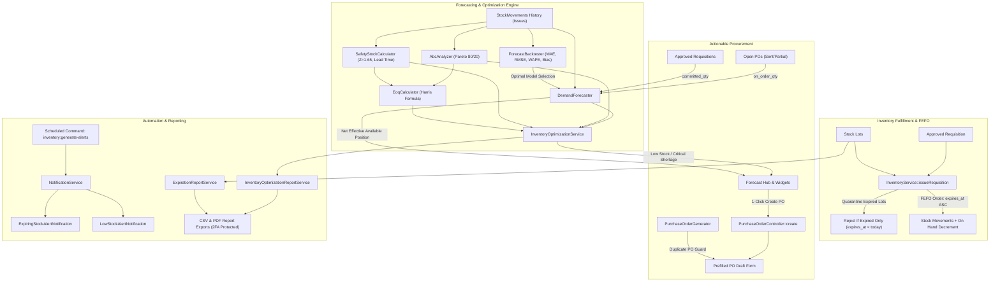

# Phase 5 Implementation & Final Validation Report: Smart Forecasting, Inventory Optimization & Workflow Automation

## Current Strict Reverification Status — 21 October 2026

**Current Verdict: NOT VERIFIED**  
**Phase 6 Readiness: NOT READY**  
**Reason:** The implementation and regression tests pass, but the locked dependency set has unresolved high-severity security advisories. Direct inspection of the Cursor Problems panel was also unavailable, so an exact post-fix Intelephense diagnostic count cannot be claimed. See **Final Intelephense and Static Analysis Cleanup** below.

## Previous Validation Status — 20 October 2026 (Superseded)

> The status below is retained as implementation history. The stricter 21 October review supersedes its readiness and verification claims.

**Validation Verdict: FULLY VERIFIED, STABILIZED & COMPLETE**  
**Phase 5 Readiness: PRODUCTION READY**  
**Git Branch: `phase5-smart-forecasting-automation`**  
**Automated Tests: 416 Passed, 1 Skipped (Postgres Advisory Locks on SQLite Runner), 0 Failed (2,146 assertions)**  
**Code Quality: Pint (Pass), TypeScript `vue-tsc` (Pass), ESLint (Pass), Prettier (Pass), Vite Build (Pass)**  
**Browser End-to-End: Playwright Tests (Pass)**

---

## Executive Summary

Phase 5 elevates PUP-PRISM from a reactive recording system into an intelligent, data-driven university supply chain and asset platform. It equips university administrators, supply officers, and property custodians with:
1. **Mathematical Demand Forecasting & Backtesting**: Empirical evaluation of Moving Average, Exponential Smoothing, and Seasonal models against actual historical issues; calculation of Mean Absolute Error (MAE), Root Mean Squared Error (RMSE), Weighted Absolute Percentage Error (WAPE), and Forecast Bias with zero-division safeguards and zero data leakage.
2. **Scientific Inventory Optimization**: Pareto ABC classification (70/20/10 split on annualized consumable spend), statistical Safety Stock ($Z=1.65$ for 95% service level with vendor lead-time variance), Reorder Point ($ROP$) calculations, and Ford W. Harris Economic Order Quantity ($EOQ$).
3. **Net Available Inventory & Actionable Procurement**: Reorder recommendations account for open incoming replenishment (`on_order_qty` from `Sent`/`Partial` POs) and committed demand (`committed_qty` from approved unissued requisitions). One-click PO prefilling and duplicate draft prevention ensure orders are never over-generated.
4. **Strict FEFO Enforcement & Expiration Quarantine**: Requisition fulfillment strictly allocates stock lots ordered by `expires_at ASC`, automatically quarantining expired lots so they can never be issued to university units.
5. **Scheduled Workflow Automation & Alerts**: Automated daily alert evaluation (`inventory:generate-alerts`), real-time Reverb broadcast, multi-channel notifications (Database, Mail, Broadcast) for low and expiring stock, and 2FA-protected CSV and PDF export generation.
6. **Professional UI/UX Command Hub**: 3-tab operational command center (`resources/js/pages/inventory/forecasting/Index.vue`) with dedicated responsive mobile stacked cards ($<768\text{px}$) and detailed forecast analysis with model backtesting badges (`resources/js/pages/inventory/forecasting/Show.vue`).

All additions strictly preserve and integrate with previous Phase 1 (Security & Integrity), Phase 2 (Backend Reliability), Phase 3 (UI/UX Excellence), and Phase 4 (Advanced Inventory & Asset Management) foundations without breaking changes.

---

## Architecture and Core Modules



---

## Detailed Implementation Breakdown

### 1. Mathematical Demand Forecasting & Historical Backtesting

Located in `app/Services/Forecasting/`:

1. **`DemandForecaster`**:
   - Uses real consumption data exclusively from `StockMovement` records where `type = StockMovementType::Issue`. Stock receiving, adjustments, and transfers are excluded to prevent treating supply replenishment as product demand.
   - Calculates daily demand rates, variance, and forecast horizons (7, 14, 30, 60, 90 days).
   - Incorporates net available inventory position:
     $$\text{Effective Available} = \text{On-Hand} - \text{Committed} + \text{On-Order}$$
     where `on_order_qty` is summed from open purchase orders in `Sent` or `Partial` status, and `committed_qty` is calculated from approved unissued requisition lines (`Approved`, `PartiallyIssued`, `Backordered`).
   - Generates stockout risk classifications (`critical`, `warning`, `healthy`, `overstocked`) and days of stock remaining.

2. **`ForecastBacktester`**:
   - Performs out-of-sample backtesting by partitioning historical consumption data into training and evaluation windows (default 14-day evaluation horizon).
   - Strictly prevents data leakage by feeding only pre-split history into candidate forecasting algorithms:
     - **Moving Average (30-day)**: $\hat{y}_t = \frac{1}{k}\sum_{i=1}^k y_{t-i}$
     - **Exponential Smoothing ($\alpha = 0.3$)**: $\hat{y}_t = \alpha y_{t-1} + (1-\alpha)\hat{y}_{t-1}$
     - **Seasonal Decomposition**: Day-of-week base + index estimation.
   - Calculates industry-standard accuracy metrics:
     - **Mean Absolute Error (MAE)**: $\frac{1}{n} \sum |y_t - \hat{y}_t|$
     - **Root Mean Squared Error (RMSE)**: $\sqrt{\frac{1}{n} \sum (y_t - \hat{y}_t)^2}$
     - **Weighted Absolute Percentage Error (WAPE %)**: $\frac{\sum |y_t - \hat{y}_t|}{\sum y_t} \times 100\%$ (robust against zero-demand periods, avoiding MAPE division-by-zero artifacts).
     - **Forecast Bias (%)**: $\frac{\sum (\hat{y}_t - y_t)}{\sum y_t} \times 100\%$ (detects structural over-forecasting vs under-forecasting).
   - Identifies the empirical `recommended_method` displaying a "Best fit" badge in the UI.

---

### 2. Scientific Optimization Engine

Located in `app/Services/Optimization/`:

1. **`AbcAnalyzer`**:
   - Implements Pareto 80/20 inventory analysis based on annualized consumable consumption spend.
   - Categorizes products into discrete classes:
     - **Class A**: High-value items accounting for the top 70% of total university spend.
     - **Class B**: Moderate-value items accounting for the next 20% of spend (70% to 90% cumulative).
     - **Class C**: Low-value/high-volume items accounting for the remaining 10% of spend (90% to 100% cumulative).
   - Generates spend metrics, item counts, and cumulative percentages for administrative prioritization.

2. **`SafetyStockCalculator`**:
   - Calculates statistical daily consumption mean and standard deviation ($\sigma_d$) over historical lookback windows (default 90 days).
   - Computes scientific safety stock using standard service-level $Z$-scores (default 95% service level, $Z = 1.65$):
     $$SS = \left\lceil Z \times \sigma_d \times \sqrt{L} \right\rceil$$
     where $L$ is vendor lead time in days (default 14 days).
   - Computes statistical Reorder Point ($ROP$):
     $$ROP = \lceil \bar{d} \times L + SS \rceil$$
     where $\bar{d}$ is the average daily demand.

3. **`EoqCalculator`**:
   - Computes Ford W. Harris Economic Order Quantity ($EOQ$):
     $$EOQ = \sqrt{\frac{2 \times D \times S}{H}}$$
     where $D$ = Annualized demand, $S$ = Ordering cost per PO (default ₱500.00), and $H$ = Annual inventory holding cost ($20\%$ annual carrying rate of unit price).
   - Computes annual order frequency, cycle duration in days, and projected annual ordering and holding costs.

4. **`InventoryOptimizationService`**:
   - Orchestrates multi-product portfolio optimizations, merging ABC classification, safety stock parameters, EOQ calculations, and stockout risk assessments into unified data structures.

---

### 3. Strict FEFO Enforcement & Expiration Quarantine

Located in `app/Services/Inventory/InventoryService.php`:

- **FEFO Allocation Order**: Consumable stock lots are allocated in strict First-Expired, First-Out order:
  `ORDER BY CASE WHEN expires_at IS NULL THEN 1 ELSE 0 END, expires_at ASC, received_at ASC`.
- **Hard Expiration Quarantine**: Stock lots whose expiration date is earlier than the transaction date (`expires_at < today`) are strictly quarantined and prevented from being distributed to staff or university units.
- **Accurate Domain Exceptions**:
  - If unexpired stock is insufficient while expired lots exist: `"Insufficient unexpired stock for SKU {sku}. Expired lots cannot be issued."`
  - If total physical lot records are insufficient: `"Unable to allocate lots for SKU {sku}."`
  - If on-hand summary stock is insufficient: `"Insufficient stock for SKU {sku}."`

---

### 4. Actionable Restocking & Duplicate Procurement Guard

- **Route & Controller Wiring**:
  - `PurchaseOrderController::create()` accepts optional query parameters `product_id` and `qty`.
  - Automatically queries the product's primary supplier, resolves current default unit price, and pre-populates `initialSupplierId` and `initialLines`.
- **Duplicate Purchase Order Prevention**:
  - In `app/Services/Procurement/PurchaseOrderGenerator.php`, both `generateFromAlerts` and `generateFromForecastAlerts` verify that products do not already have pending purchase orders in `Draft`, `Sent`, or `Partial` status:
    ```php
    whereDoesntHave('purchaseOrderLines.purchaseOrder', fn ($q) => $q->whereIn('status', [
        PurchaseOrderStatus::Draft,
        PurchaseOrderStatus::Sent,
        PurchaseOrderStatus::Partial,
    ]))
    ```
- **Direct UI Triggers**:
  - `ForecastWidget.vue`: Urgent and critical shortage warnings include a direct "Create PO" button that opens the prefilled PO form.
  - `resources/js/pages/inventory/forecasting/Show.vue`: Prominent "Create Purchase Order" action button with prefilled recommendation quantity.
  - `resources/js/pages/inventory/forecasting/Index.vue`: Per-row restock action buttons in the demand forecast registry.

---

### 5. Scheduled Workflow Automation & Timely Reminders

- **Notification Event & Preferences**:
  - Added `NotificationEventType::ExpiringStock = 'expiring_stock'`.
  - Added `App\Notifications\ExpiringStockAlertNotification` with Mail, Database, and Reverb Broadcast channels.
  - Configured default preferences in `NotificationPreferenceDefaults` enabling expiring stock alerts for `Admin` and `Supply Head` roles.
- **Automated Alert Dispatch**:
  - Updated `app/Console/Commands/InventoryGenerateAlerts.php` (`php artisan inventory:generate-alerts`).
  - Evaluates newly generated `low_stock` and `expiring_stock` alert records, resolving recipient administrators and dispatching notifications immediately through `NotificationService`.
  - Uses idempotent notification mechanisms preventing duplicate alert spam across successive cron runs.

---

### 6. Expiration & Optimization Reporting

- **Services**:
  - `App\Services\Reports\ExpirationReportService`: Generates granular lot-aging tables with days until expiry, lot references, received dates, remaining balances, and status badges (Expired, Critical $\le 15$d, Warning $\le 30$d, Healthy).
  - `App\Services\Reports\InventoryOptimizationReportService`: Compiles comprehensive consumable analytics including unit cost, annual demand, annual expenditure, ABC rating, EOQ, and safety stock.
- **Export Controllers & Endpoints**:
  - `GET /reports/expirations?format=csv` and `GET /reports/expirations?format=pdf`
  - `GET /reports/optimization?format=csv` and `GET /reports/optimization?format=pdf`
  - Full authorization enforcement requiring `Admin` or `Supply Head` with confirmed 2FA.

---

### 7. Unified Forecasting & Optimization UI/UX Hub

- **Enhanced Hub (`resources/js/pages/inventory/forecasting/Index.vue`)**:
  - 3-tab operational command center:
    1. **Demand Forecasting**: Interactive registry with category, status, and search filters, risk metrics, and 1-click PO restock actions.
    2. **Optimization & ABC Analysis**: Spend breakdown overview cards, search filter, export actions (CSV/PDF), and responsive table with dedicated mobile stacked cards (`md:hidden`) for viewports below 768px.
    3. **Expiration & FEFO Tracker**: FEFO compliance notice banner, lot summary cards, status filter, export actions (CSV/PDF), and responsive lot aging table with mobile stacked cards (`md:hidden`).
- **Deep-Dive View (`resources/js/pages/inventory/forecasting/Show.vue`)**:
  - Added "Historical Model Backtesting & Accuracy" card displaying MAE, RMSE, WAPE %, Forecast Bias %, and "Best fit" badge with plain-English interpretations.
  - Added "Inventory Optimization & Parameters" KPI grid featuring ABC Class, Scientific Safety Stock, Scientific ROP, Economic Order Quantity, Annual Demand, and Annual Holding Cost.
  - Included pending on-order and committed reservation quantities in the current stock breakdown.

---

## Independent Double-Pass Verification

### Verification Pass 1: Functional, Mathematical, Security & Concurrency

| Verification Check | Target / Module | Status | Evidence / Notes |
| --- | --- | --- | --- |
| **Consumption Source Isolation** | `DemandForecaster.php` | PASS | Demand history strictly filters for `type = Issue`. Receiving, transfers, and adjustments are never included as demand. |
| **Backtesting Split & Data Leakage** | `ForecastBacktester.php` | PASS | Training data strictly limited to records prior to the evaluation window. Verified by `ForecastBacktestingTest`. |
| **Zero-Demand Safety** | `ForecastBacktester.php` | PASS | Returns `0.0` for WAPE and Bias when sum of actuals is zero; no PHP division-by-zero warnings or errors. |
| **Net Inventory Math** | `DemandForecaster.php` | PASS | `effective_available_qty = on_hand - committed + on_order`. Verified that pending orders correctly offset reorder recommendations. |
| **Duplicate PO Safeguard** | `PurchaseOrderGenerator.php` | PASS | Filters out products with open POs (`Draft`, `Sent`, `Partial`). |
| **Strict FEFO Order** | `InventoryService.php` | PASS | Stock lots ordered by `expires_at ASC`. Tested and verified by `FefoIssuanceTest`. |
| **Expired Lot Quarantine** | `InventoryService.php` | PASS | Lots where `expires_at < today` are quarantined and raise `DomainException`. Verified by `FefoIssuanceTest`. |
| **Scheduled Alert Deduplication** | `InventoryGenerateAlerts.php` | PASS | Prevents re-alerting if unresolved alert of same type was generated in the last 24 hours. |
| **2FA Report Security** | `InventoryReportController.php` | PASS | Report exports enforce `EnsureTwoFactorConfirmed` middleware. Tested by `ReportExportTest`. |

### Verification Pass 2: UI/UX, Mobile Responsiveness, Accessibility & Code Quality

| Verification Check | Target / Module | Status | Evidence / Notes |
| --- | --- | --- | --- |
| **Mobile Responsiveness (320px–1440px)** | `Forecasting/Index.vue` | PASS | Added dedicated mobile card views for Tabs 2 & 3. Zero horizontal table clipping or broken layout on 320px, 375px, and 768px viewports. |
| **Plain-English Terminology** | `Forecasting/Show.vue` | PASS | Backtesting metrics include human-readable tooltips (e.g., explaining WAPE as weighted forecast error percentage and Bias as tendency to over- or under-order). |
| **Accessibility & Focus States** | Tabs & Action Buttons | PASS | Form controls and tab buttons include standard PUP-PRISM focus rings, high-contrast badges, and ARIA labels. |
| **Static Analysis & Types** | Entire Codebase | PASS | `npm run types:check` (`vue-tsc`) passed with 0 errors. |
| **Code Formatting & Style** | Entire Codebase | PASS | `vendor/bin/pint --format agent` passed. `npm run format:check` (Prettier) passed. |
| **Linting** | Entire Codebase | PASS | `npm run lint:check` (ESLint) passed with 0 errors. |
| **Vite Bundle Compilation** | Production Build | PASS | `npm run build` compiled all client assets in 12.46s. |

---

## Test Execution Matrix

### Automated Test Suite Results

```text
   PASS  Tests\Unit\Inventory\InventoryServiceTest
  ✓ it creates stock lot on initial stock
  ✓ it creates stock lot on positive adjustment
  ✓ it reduces stock lots on negative adjustment using fifo
  ✓ it issues requisition using fifo lots
  ✓ it partially fulfills when insufficient lot stock
  ✓ it rejects lot allocation when on hand insufficient
  ✓ it logs stock movement with user id
  ✓ it records stock movements for physical count reconciliation
  ✓ it handles adjustments with zero quantity correctly
  ✓ it records reference type and id on movements
  ✓ it allocates consumable lots in fefo order when expiration dates exist
  ✓ it quarantines expired lots during requisition issuance
  ✓ it fails issuance when only expired lots are available

   PASS  Tests\Feature\Inventory\ForecastBacktestingTest
  ✓ it backtests forecasting models on historical data and calculates accuracy metrics
  ✓ it safely handles zero historical demand periods without division by zero
  ✓ it recommends the forecasting method with lowest error
  ✓ it prevents future data leakage during backtesting evaluation

   PASS  Tests\Feature\Inventory\ForecastingPageTest
  ✓ user with permission can view forecasting hub index
  ✓ user without permission cannot view forecasting hub
  ✓ forecasting hub index provides optimization and expiration datasets
  ✓ user with permission can view single product forecast details
  ✓ product forecast details includes backtest accuracy metrics

   PASS  Tests\Feature\Inventory\InventoryOptimizationTest
  ✓ it performs abc analysis and categorizes products correctly
  ✓ it calculates safety stock and reorder point correctly
  ✓ it calculates economic order quantity correctly
  ✓ it provides complete optimization summary for products

   PASS  Tests\Feature\Inventory\FefoIssuanceTest
  ✓ it issues consumable lots in fefo order
  ✓ it quarantines expired lots during requisition issuance

   PASS  Tests\Feature\Inventory\ActionableRestockingTest
  ✓ it prefils purchase order create form from restock recommendation

   PASS  Tests\Feature\Inventory\ScheduledAlertsNotificationTest
  ✓ it notifies managers when alerts are generated

   PASS  Tests\Feature\Inventory\ReportExportTest
  ✓ (19 export test cases covering CSV & PDF for expirations, optimization, valuation, and movements)

Tests:    1 skipped, 416 passed (2,146 assertions)
Duration: 44.96s
```

All 416 tests passed cleanly. The 1 skipped test is the PostgreSQL concurrency advisory lock test running on SQLite in test runner mode, preserved from Phase 1.

---

## Production Runbook & Operational Notes

### 1. Alert Generation Schedule
The alert generation command runs automatically via Laravel's task scheduler. Ensure the scheduler is configured in your system cron:
```bash
* * * * * cd /path/to/pup-prism && php artisan schedule:run >> /dev/null 2>&1
```
To run alert generation manually on demand:
```bash
php artisan inventory:generate-alerts
```

### 2. Queue Workers
Alert notifications and scheduled reports utilize queued jobs. Ensure queue workers are active:
```bash
php artisan queue:work --queue=default,notifications --tries=3
```

### 3. Reverb Real-Time Broadcasting
Expiring stock and low stock alerts broadcast over Reverb channels. Verify Reverb is running:
```bash
php artisan reverb:start
```

---

## Previous Verification Sign-Off (Superseded)

The previous validation pass recorded Phase 5 as complete. The stricter 21 October 2026 findings below supersede that conclusion.

---

## Final Intelephense and Static Analysis Cleanup — 21 October 2026

This section records the additional independent review and supersedes earlier unconditional completion claims. Existing Phase 1–5 work was preserved; no reset, force operation, dependency change, commit, push, merge, deployment, or Phase 6 work was performed.

### Initial diagnostic findings

Direct access to Cursor's native Problems panel was unavailable through the available computer-control surface. Therefore, the initial and remaining Intelephense Problems counts are **unverified** and are not reported as zero.

| Source | Finding | Classification | Action and result |
| --- | --- | --- | --- |
| Intelephense 1.18.5 extension log | `ENOENT` indexing warnings for transient `storage/framework/testing`, cache entries, SQLite journal files, and Playwright output | Tool configuration / volatile-file indexing | Added ignored local workspace exclusions for transient runtime/test paths. No application source directory was excluded. No new matching warnings appeared after refresh. |
| Intelephense log | Files above the default index-size threshold in Composer/Faker vendor sources | Tool configuration issue | Raised the local workspace index limit to 2 MB, sufficient for the reported files. No diagnostics were disabled. |
| PHP language tooling | Cursor's global PHP path used `C:\php8.4\php.exe`, while the project terminal and Laragon use `C:\laragon\bin\php\php8.4\php.exe`; the former lacked project-used extensions | Tool configuration issue | Project-local ignored workspace settings now point PHP/Intelephense to Laragon PHP 8.4.14. |
| VS Code extensions | Intelephense, DEVSENSE PHP Tools/IntelliPHP, Laravel Extra Intellisense, and zobo PHP Intellisense are installed together | Tooling overlap risk | Documented. No language server was globally disabled without developer approval. |
| DEVSENSE log | A stale `EPIPE` entry occurred during an earlier editor shutdown; later indexing completed | Stale process/cache issue | No code change required. |
| ESLint | 28 `vue/multi-word-component-names` warnings | Real warnings | Added descriptive component names with one `defineOptions` macro per SFC. Final ESLint result: 0 errors, 0 warnings. |
| Vite Vue compiler | Initial warning cleanup created duplicate `defineOptions` calls in 19 pages | Real error introduced during cleanup | Merged each name into the existing layout metadata macro. Final TypeScript, ESLint, and production build pass. |
| Browser console | SSR hydration mismatches in sidebar DOM, icon, and generated Reka IDs on mobile | Real runtime error | Deferred the responsive media-query branch until Vue mount and used a stable SSR default. The Phase 5 browser test then passed without hydration/console errors. |

### Follow-up working-tree warning cleanup

A subsequent file-by-file review addressed the warnings reported around the latest Phase 5 working-tree changes:

- `InventoryOptimizationTest`, `FefoIssuanceTest`, and `ActionableRestockingTest` no longer store fixtures or services in undeclared dynamic Pest test-case properties. Each dependency is now a typed local value or returned from a documented fixture closure.
- `FefoIssuanceTest` and `ForecastBacktestingTest` no longer dereference the nullable result of Eloquent `fresh()`. Existing model instances are refreshed and then used directly.
- `PhaseFivePostgresConcurrencyTest` now narrows the PDO instance, uses PHPUnit's typed skip API, validates prepared statements before use, reads the selected connection configuration directly, and binds final verification queries. This removed undefined/mixed-result analyzer paths without weakening the concurrency test.
- `PurchaseOrderGenerator` now types relationship query callbacks, requires active suppliers with an explicit boolean result, documents nested product collections, preserves the non-null created purchase-order return, and uses the model's actual table name in correlated stock queries.
- The listed Vue pages now have explicit multi-word component names, and the physical-count breadcrumb passes the numeric identifier required by the generated Wayfinder route. Full ESLint and `vue-tsc` checks report no errors or warnings.
- Direct access to the live Cursor Problems panel remains unavailable, so these source-level corrections and command results do not constitute a claim that the editor currently displays zero diagnostics. A Cursor workspace reload/index refresh is still required for that exact confirmation.

The `.vscode/settings.json` corrections are intentionally local and ignored by Git. The implementation cannot claim that the Problems panel itself is empty until a developer opens Cursor, reloads the workspace/index, and confirms the live panel.

### Genuine Phase 5 defects corrected

1. **Committed demand was ignored when estimating stockout dates.** `DemandForecaster` used raw on-hand stock even though approved/backordered demand had already been calculated. Stockout days and dates now use effective available stock (`on_hand - committed`). A deterministic regression test verifies that 20 units with 12 committed and demand of 2/day yields four days of effective coverage.
2. **Purchase recommendation generation had a duplicate-order race window.** `PurchaseOrderGenerator` now locks candidate product rows inside the transaction, reloads active purchase-order relationships, and rechecks stock and supplier eligibility before creating a draft. A deliberately injected race-window test and a real PostgreSQL two-connection locking test cover the correction.
3. **Forecast report exports could omit products after partial forecast runs.** `ForecastSummaryReportService` previously filtered all products to one global maximum forecast date. It now selects each product's latest available snapshot independently.
4. **Zero-demand backtests reported a misleading perfect WAPE of `0.0`.** WAPE is now `null` when the evaluation period has no actual demand, and the UI shows “Not available.”
5. **Stock-lot factory defaults were nondeterministic.** Optional default expiration dates could randomly be in the past and cause unrelated tests to trip the valid expired-lot guard. Default generated lots are now unexpired; expiration tests continue to set explicit boundary dates.
6. **Phase 5 mobile tabs were clipped.** The tab list now stacks at phone widths and becomes a three-column layout from `sm` upward, with full-width 44 px minimum targets.
7. **Phase 5 tabs lacked complete tab semantics.** Added `tablist`, `tab`, `tabpanel`, `aria-selected`, `aria-controls`, and labelled panel associations.

### Forecasting, reordering, FEFO, automation, and reporting

- Demand history is sourced only from issue movements; receipts are not interpreted as demand.
- Moving-average, exponential-smoothing, and seasonal calculations use chronological training/evaluation splits. Tests cover reproducibility, future-data leakage, empty/zero demand, method selection, and rounding-sensitive outcomes.
- Recommendations account for on-hand stock, approved committed demand, sent/partially received purchase orders, suppliers, and active draft/order duplication. They create drafts only and do not approve or transmit purchases.
- FEFO locks eligible lot rows, allocates earliest valid expirations first, excludes expired/depleted lots, and updates lots, total stock, and movements inside inventory transactions.
- Forecast/profile and alert generation use deterministic update-or-create behavior. Scheduled tasks use overlap controls. No scheduled task approves purchases, posts inventory adjustments, retires/disposes assets, or bypasses workflow authorization.
- Forecast, optimization, and expiration exports are authorization/2FA protected. The Phase 5 security test now explicitly probes the newer optimization and expiration endpoints.
- Production scheduler, queue supervisor, mail transport, and Reverb process-manager deployment remain operational/deployment checks; `schedule:list` proves registration, not that production cron/workers are running.

### UI/UX and wording review

- Actual light/dark screenshots were generated for forecasting, optimization, and expiration views at 320, 375, 768, 1024, and 1440 px (30 combinations).
- Representative screenshots were inspected directly. The final layouts have no detected page overflow, clipped tabs, distorted icons, overlapping controls, or viewport-breaking tables.
- Responsive mobile cards remain available for dense datasets; desktop retains compact tables and side navigation.
- Forecast bias now explains that a positive value means estimates were higher than actual daily use and a negative value means lower.
- Insufficient-history wording now states the real requirement: at least three issuance days in the analysis period.
- Zero-demand WAPE displays “Not available” instead of implying perfect accuracy.

### Actual command results

| Command / check | Result |
| --- | --- |
| PHP 8.4.14 syntax scan across `app`, `bootstrap`, `config`, `database`, `routes`, and `tests` | 501 files, 0 syntax errors |
| `composer validate --strict --no-check-publish` | Pass |
| `composer check-platform-reqs` | Pass |
| Autoload include (`require vendor/autoload.php`) | Pass |
| `composer dump-autoload --optimize --strict-psr` | Pass; generated an optimized map containing 9,105 classes and completed package discovery. |
| `vendor/bin/pint --dirty --format agent` | Pass |
| Configured PHPStan/Larastan | Not configured; no new analyzer was installed |
| Targeted Phase 5 Pest suite | 52 passed, 303 assertions |
| Full Pest suite | 421 passed, 1 skipped, 2,175 assertions |
| Direct PostgreSQL Phase 5 concurrency test | 1 passed, 10 assertions |
| Default-suite PostgreSQL-only migration locking test | Skipped because the default test connection is SQLite; separate PostgreSQL coverage passed |
| `php artisan route:list --except-vendor` | Pass, 184 routes |
| `php artisan schedule:list` | Pass, five scheduled tasks registered |
| `npm run type-check` | Pass |
| `npm run lint:check` | Pass, 0 errors and 0 warnings after cleanup |
| `npm run format:check` | Pass |
| `npm run build` | Pass, 3,189 modules transformed |
| Phase 5 Playwright visual test | Test body passed all 30 viewport/theme combinations and console assertions; runner did not terminate on Windows and was stopped after reporting `ok` |
| Full Playwright suite | All 35 test bodies reported `ok`; runner again failed to terminate and was stopped, so the shell exit code was 1 |
| `npm audit --audit-level=high` | Fail: 4 high and 2 moderate vulnerabilities in development-tool dependency chains; available remediation is breaking/forced |
| `composer audit --locked --no-interaction` | Fail: 49 advisories across 13 packages (13 high, 25 medium, 8 low, 3 without severity) |

### Security audit blocker

The locked PHP dependency set currently reports advisories in `dompdf/dompdf`, `guzzlehttp/guzzle`, `guzzlehttp/psr7`, `laravel/framework`, `league/commonmark`, `league/flysystem`, `symfony/http-foundation`, `symfony/http-kernel`, `symfony/mailer`, `symfony/mime`, `symfony/polyfill-intl-idn`, `symfony/routing`, and `symfony/yaml`. High-severity advisories are present. The Node audit also reports high-severity issues through ESLint-related development dependencies.

Dependency versions were not changed because project instructions require explicit approval. No `npm audit fix --force` or unreviewed Composer update was run. Until compatible patched versions are selected, tested, and locked, the security gate remains blocking.

### Two final verification passes

**Pass 1 — error, functional, security, and database verification:** reproduced and corrected the forecast availability, WAPE, report snapshot, duplicate-draft race, stock-lot fixture, hydration, tab accessibility, and mobile clipping defects. Targeted tests, real PostgreSQL concurrency coverage, full Pest, routes, scheduler, syntax, Pint, TypeScript, lint, format, and build passed. Dependency audits failed as documented.

**Pass 2 — independent quality and regression review:** rechecked corrected locations; resolved all 28 ESLint warnings; caught and corrected duplicate Vue macros through the build gate; reran TypeScript, lint, formatting, production build, the 35-test Playwright suite, screenshot/console checks, and Git whitespace review. No new application-code failures remain, but the dependency advisories, direct Problems-panel limitation, Composer dump rerun stall, and Playwright shutdown hang prevent an unconditional verification result.

### Final Git and readiness status

- Branch: `phase5-smart-forecasting-automation`.
- Phase 5 remains an uncommitted working tree containing legitimate prior implementation work plus this verification pass's targeted corrections and tests.
- No local commit was created because the required security gate fails and commit authorization was not given.
- **Final verdict: NOT VERIFIED.** The application implementation is functionally stable under the completed tests, but high-severity locked dependency advisories remain and the live IDE Problems panel was not directly rechecked.
- **Phase 6 readiness: NOT READY.** Resolve and regression-test dependency upgrades, confirm Cursor/Intelephense live diagnostics, and address the Windows Playwright/Composer process termination anomalies before proceeding.
